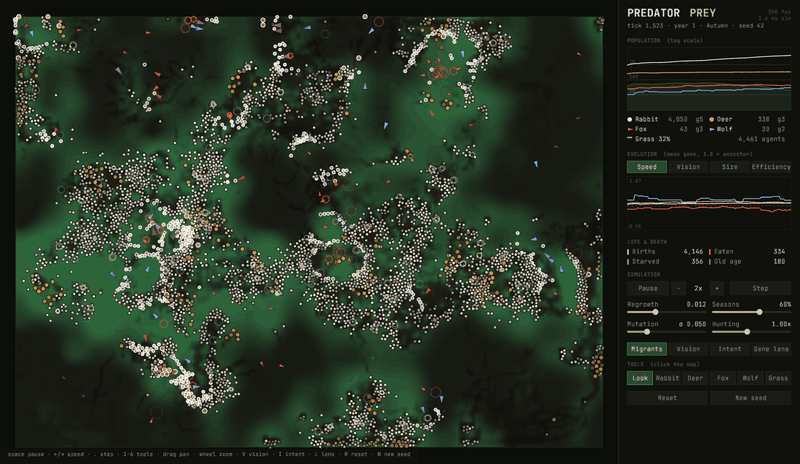
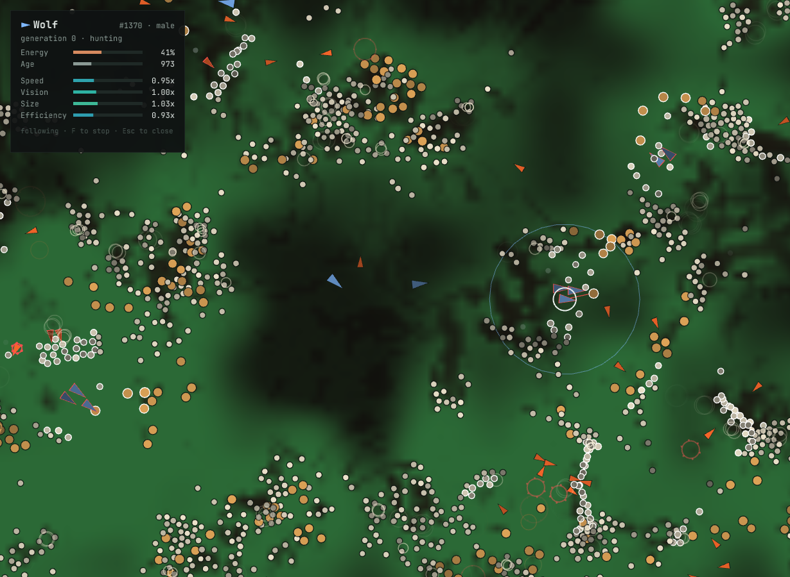

# Predator · Prey

**A living ecosystem in Rust: thousands of rabbits, deer, foxes and wolves graze, hunt, breed, starve and evolve in real time, natively or in your browser.**

[](https://github.com/theomilll/PredatorPreySimulator/actions/workflows/ci.yml)

### [▶ Run it in your browser](https://theomilll.github.io/PredatorPreySimulator/)



## What you are looking at

- **Grass** (green field): every cell grows, spreads to its neighbours and gets eaten. Fertile meadows and barren patches come from a seeded noise map. Winter turns it pale and slows growth.
- **Rabbits** (cream) and **deer** (amber) are the circles. They graze, herd and run.
- **Foxes** (orange) and **wolves** (blue) are the triangles, pointing where they move. Foxes hunt rabbits. Wolves hunt deer, and rabbits when no deer are in sight.
- **Brightness is energy.** A starving animal fades toward the background.
- **Rings are life events.** A small ring in the species colour is a birth. A red burst is a kill. A grey dot is starvation, a blue one old age.
- **The panel** shows population on a log scale (grass is the shaded area), the mean of each gene per species over time, and counts of births and deaths by cause.

## Features

- **Thousands of agents at 60 fps.** A counting-sort spatial grid gives each animal its neighbours without an O(n²) scan. One tick costs about 0.6 ms with 1,000 animals and about 7 ms when 8,000 are packed into the map (Apple M4, single thread).
- **Visible evolution.** Every animal carries four genes. Offspring get each gene from one parent, plus Gaussian mutation. You can watch the means drift in the chart, or switch on the **gene lens** to colour every animal by its value.
- **Emergent ecology.** Boom-and-bust cycles, grazing fronts that sweep across meadows, predators that overshoot and crash, and prey that survive by hiding in tall grass. None of it is scripted.
- **Deterministic.** The same seed gives the same run, tick for tick. A test checks it.
- **Interactive.** Pause, single-step, change the speed from 0.5x to 16x, drop animals anywhere, paint new meadows, tune the world while it runs, and click any animal to inspect its genome or follow it.
- **One codebase, two targets.** The same Rust builds a native window and a 1.1 MB WebAssembly module.



## How it works

Each tick runs in fixed phases, so the result never depends on iteration order:

1. **Grass grows.** Each cell follows `b += r·s·(b + ½·neighbours + 0.01)·(k − b)`. Here `k` is the local fertility and `s` is the seasonal factor `1 + strength·sin(2π·t/year)`. Grazed land grows back from its edges.
2. **Animals decide.** Each animal reads only its neighbours from the spatial grid and picks the first rule that applies:
   - flee the nearest visible predator;
   - if hungry, hunt the nearest preferred prey (aiming ahead of it), or graze, or walk toward the lushest grass in sight;
   - if well fed and adult, court the nearest willing mate;
   - otherwise wander, with herding for deer and rabbits and packing for wolves.
3. **Animals act.** Velocities ease toward the chosen direction, animals move and pay their energy costs, and herbivores eat.
4. **Interactions resolve.** A predator in contact rolls to kill. The odds depend on its speed and size against the prey's. A female next to a willing male gives birth to a litter.
5. **Deaths.** Animals die of predation, starvation or old age, and the counts feed the charts.

**Energy is conserved through reproduction.** The mother pays half her maximum energy, and that energy is split across the litter. Large litters mean weak young, and well-fed populations grow faster than starving ones.

**Tall grass hides rabbits.** A predator only notices a rabbit standing in tall grass from very close. When rabbits are rare the grass grows tall and hides the survivors. When they are plentiful they graze it short and lose their cover.

**Migrants.** When a species drops below six animals, small groups occasionally walk in from the map edge. This keeps the show going after a crash. You can turn it off.

### Genes are trade-offs

| Gene | Helps | Costs |
|---|---|---|
| Speed | Outrun predators or catch prey | Basal metabolism grows with speed², and moving fast costs more |
| Vision | Spot food, mates and threats earlier | Constant energy drain |
| Size | More energy storage, better odds in a fight | Proportionally higher metabolism |
| Efficiency | Lower metabolism | Slower to reach maturity |

With no predators around, rabbits slowly get slower, because speed is pure cost. When foxes boom, faster rabbits survive and the speed curve climbs.

### Species

| | Speed | Vision | Max energy | Lifespan (ticks) | Litter | Eats |
|---|---|---|---|---|---|---|
| Rabbit | 1.00 | 45 | 60 | 2,400 | 1–3 | grass |
| Deer | 1.15 | 70 | 120 | 4,800 | 1 | grass |
| Fox | 1.20 | 60 | 90 | 3,000 | 1–2 | rabbits |
| Wolf | 1.30 | 85 | 160 | 4,200 | 2–3 | deer, then rabbits |

## Controls

| Input | Action |
|---|---|
| `Space` | Pause or resume |
| `←` `→` | Slow down or speed up |
| `.` | Step one tick |
| `1`–`6` | Tools: look, rabbit, deer, fox, wolf, grass |
| Click | Inspect an animal, or use the selected tool |
| Drag, right-drag | Pan |
| Wheel | Zoom |
| `F` | Follow the selected animal |
| `V` `I` `L` | Vision radii, intent lines, gene lens |
| `R` `N` | Restart the same seed, or start a new one |

## Run it

You need a stable Rust toolchain (1.88 or newer).

```sh
cargo run --release -p predator-prey
```

To build the web version:

```sh
rustup target add wasm32-unknown-unknown
cargo build --release -p predator-prey --target wasm32-unknown-unknown
mkdir -p _site && cp web/* target/wasm32-unknown-unknown/release/predator-prey.wasm _site/
python3 -m http.server -d _site 8000
```

Then open <http://localhost:8000>.

To run the simulation headless and benchmark it:

```sh
cargo run --release -p ecosim --example headless -- 42 20000
```

Run the tests with `cargo test`.

## Project layout

```
sim/   ecosim: the simulation as a pure library (depends only on glam)
app/   predator-prey: the macroquad front end (rendering, HUD, input)
web/   HTML shell and the miniquad JS loader for the WebAssembly build
```

The simulation does not know it is being drawn. The front end reads the world state and a per-tick event list (births and deaths) and turns them into pixels.

---

This is a rewrite of the original Python and Tkinter version, which is still in the git history at [`f3789c7`](https://github.com/theomilll/PredatorPreySimulator/tree/f3789c7).
